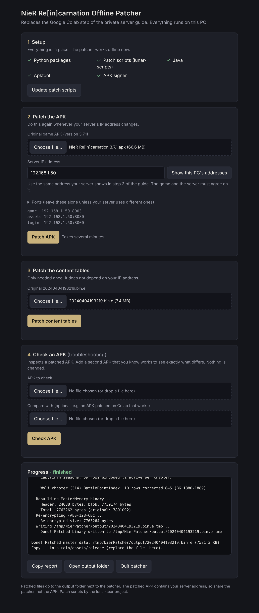
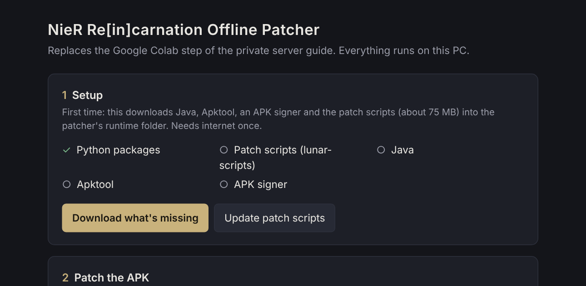
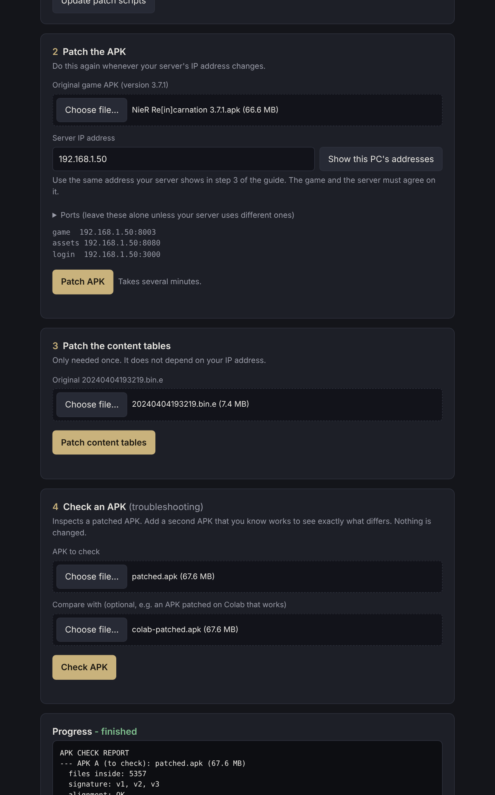

# NieR Re[in]carnation Offline Patcher

A small Windows tool that patches the NieR Re[in]carnation APK and content
tables for use with a [lunar-tear](https://github.com/Walter-Sparrow/lunar-tear)
private server, on your own PC, without Google Colab.

The lunar-tear setup normally has you upload the game's APK and master data to
Google Drive and run a Colab notebook to patch them. That works, but it depends
on an online service staying available, and the APK has to be re-patched every
time your server's IP address changes. This tool does the same job locally.
After its first run it needs no internet at all.

**This is a wrapper, not a new patch.** All of the actual patching is done by
the lunar-tear authors' own scripts
([lunar-scripts](https://gitlab.com/walter-sparrow-group/lunar-scripts)), which
this tool downloads and runs unchanged. See [Credits](#credits).

> **AI disclosure.** All of the code, research and documentation in this
> repository was written by Claude, Anthropic's AI model. The repository owner
> directed the work and tested it on real hardware, and did not write the code.
> Details are in [How this was made](#how-this-was-made).

## What you need

- Windows 10 or 11, 64-bit
- Internet for the first run only (about 85 MB of downloads)
- Your own copies of the game files. **None are included here:**
  - `NieR Re[in]carnation 3.7.1.apk`
  - `20240404193219.bin.e`
- A lunar-tear server already set up (this tool only replaces the patching step)

## How to use it

1. Download this repository (**Code > Download ZIP**) and unzip it somewhere
   with a short path, for example `C:\NierPatcher`.
2. Double-click **`Start Patcher.bat`**. A page opens in your web browser.
   Leave the black window open while you use it.
3. **Setup:** click *Download what's missing* and wait for it to finish.

   

4. **Patch the APK:** choose the original APK, type your server's IP address
   (the one your server shows during its setup), click *Patch APK*. The ports
   default to the usual 8003, 8080 and 3000. This takes several minutes.
5. **Patch the content tables:** choose the original `20240404193219.bin.e`,
   click *Patch content tables*. This only ever needs doing once.
6. Collect your files from the `output` folder:
   - `patched.apk`: install on your phone or emulator
   - `20240404193219.bin.e`: copy into the server's `assets/release` folder

When your IP changes, start the patcher again, enter the new address, patch the
APK and install it. APKs made by the same patcher folder are signed with the
same key, so a new one installs over the old one.

## Works offline, and backs up as one folder

Everything the patcher downloads goes into its own `runtime` folder: a portable
Python, a portable Java, Apktool, an APK signer and the patch scripts. Nothing
is installed on your PC. Once setup has finished, copy the whole folder
somewhere safe and it will keep working with no internet.

## Troubleshooting

**The game shows a black screen.** Use section 4, *Check an APK*. It inspects a
patched APK and, if you give it a second APK that works, lists exactly what
differs between them. It changes nothing.

In testing, every black screen so far turned out to be the game not reaching
the server, not a bad patch. Things to check:

- The address baked into the APK must be the one your server uses. A PC often
  has several addresses (home network, VirtualBox, emulator adapters). *Show
  this PC's addresses* lists them.
- From the device or emulator's web browser, open `http://YOUR-IP:8080`. If it
  cannot connect, the game cannot either. Check Windows Firewall.
- `localhost` never works from inside an emulator.
- The game is 64-bit ARM only. It needs a 64-bit emulator instance.
- Uninstall the game completely before installing an APK signed by a different
  key (for example when moving from a Colab-patched APK to one from this tool).

**A download fails.** The page names the file and its address. Download it in a
browser, put it in `runtime\downloads` under the same name, and try again.

**Known open issue.** One LDPlayer setup still showed a black screen with an
APK that ran correctly in MuMu Player. The cause was not found.

## What has and has not been tested

- **Content tables:** the output was compared with the output of the original
  Colab notebook for the real game file and is byte-for-byte identical.
- **APK:** an APK patched with this tool from the real 3.7.1 APK was compared
  with one patched on Colab. The game code (`libil2cpp.so`) was identical and
  the only differences were the server address. That APK ran in MuMu Player.
- **Windows:** tested by the repository owner on one Windows PC.
- **Not tested:** real phones, other Windows versions, Linux and macOS (the
  code supports them in principle, see the developer notes).
- The screenshots here were taken with a small stand-in APK, so the sizes and
  counts in the check report differ from the real game's.

## Sharing

Share this repository or its ZIP, not a folder you have used. A used folder
contains your patched APK (with your server address inside) and your signing
key. The patcher saves no settings and writes no log files.

## How it works

The short version: `Start Patcher.bat` fetches a portable Python, then starts
`app/patcher.py`, which serves a single local web page as its window and runs
the same steps the Colab notebook runs. The full explanation, including what
the upstream scripts change inside the game files, is in
[docs/HOW-IT-WORKS.md](docs/HOW-IT-WORKS.md).

## How this was made

This project was built in November 2026 in a conversation between the
repository owner and Claude (Anthropic's AI model, version Claude Fable 5.2).

- **The owner** had the idea, set the requirements (offline, one folder, a
  simple window, no personal data, honest credits), supplied the game files for
  comparison, and tested every version on Windows and in emulators.
- **Claude** read the setup guide, the Colab notebook, the lunar-tear server
  source and the lunar-scripts code, worked out what the patch step does,
  designed and wrote all of the code here, wrote this documentation, and took
  the screenshots with an automated browser.

No human has reviewed the code line by line. Read it before you trust it; it is
two files, [`app/patcher.py`](app/patcher.py) and [`app/ui.html`](app/ui.html),
plus [`Start Patcher.bat`](Start%20Patcher.bat).

## Credits

This tool exists only because of other people's work. Full details and
licenses are in [CREDITS.md](CREDITS.md).

- **lunar-tear** and **lunar-scripts** by Walter-Sparrow (Ilya Groshev) and
  contributors: the private server, and the scripts that do all the patching.
- **Apktool** by Connor Tumbleson (iBotPeaches) and contributors.
- **uber-apk-signer** by Patrick Favre.
- **Eclipse Temurin** (Java) by the Eclipse Adoptium project.
- **Python**, **pycryptodome**, **msgpack** and **python-lz4**.
- The community setup guide for lunar-tear, whose step 4 this tool replaces.

## Disclaimer

This is an unofficial fan preservation tool. It is not affiliated with or
endorsed by Square Enix, Applibot, or the lunar-tear project. NieR
Re[in]carnation is the property of its owners. No game files are distributed
here; you need your own. Use it at your own risk.

## License

The code in `app/` and `Start Patcher.bat` is released under the
[MIT License](LICENSE). Third-party components keep their own licenses, listed
in [CREDITS.md](CREDITS.md).
